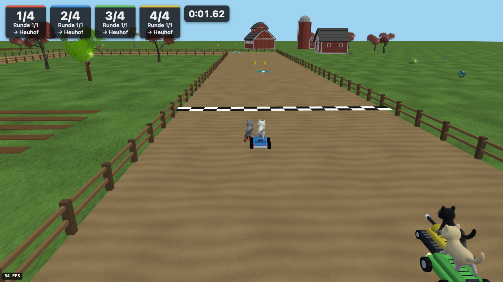

# Blacky's Mini Games

A party game for the browser with cats: a collection of minigames for 1–4 players on one screen with gamepads, filled up with AI cats.
On a phone you play with touch controls, and up to three more phones can join a host over the local Wi-Fi, each drawing the game
on its own screen. There is no server: the game is a static web page, the phones talk to each other directly (WebRTC).

Blacky is a black cat from Ukraine. His story appears on the “About Blacky” page in the game.

The public project documentation starts in [`docs/`](docs/README.md).



## Start (local)

Install dependencies and start the development server (tested with Node.js 24.16.0):

```bash
npm ci
npm run dev
```

Open the URL shown by Vite in your desktop browser. For testing on real phones over the local network, use the [HTTPS preview](tools/https-preview/README.md); that requires Docker Compose.

## Games

| Game | In short |
| --- | --- |
| Race | Several laps with items through a house, a forest, a farm, a medieval town, a city at night and a moon base |
| Time trial | One lap without items, the fastest time wins |
| Drift challenge | 60 seconds of drifting, the most points win |
| Tag | One hunter chases the others |
| Sumo karts | Ram and shove the others off a shrinking platform |
| The floor is lava (kart) | Tiles glow and disappear, the last cat on the floor wins |
| Football | Two teams push a ball into the goal |
| Memory | Turn over pairs of cats |
| The floor is lava (on foot) | Jump up stepped hills while the lava rises |
| Fighter jets | Fly, collect items and shoot down the others |

## Controls

Gamepad (standard mapping): stick or d-pad to steer and to move through menus, ✕ for gas and to confirm, ○ to brake, R to drift or jump,
Square or L for the item, Start to pause, Select for the settings. On a phone the controls are on the screen; the mouse works as a shortcut.
Every function can be reached with a gamepad alone.

## Languages

English and German. The game starts in the browser’s language if it speaks it, otherwise in English; the language can be switched in the
settings and in the lobby. Every guest phone shows its own language. All texts live in `src/shared/i18n/` (`en/`, `de/`); a new language is a
new folder there plus an entry in `LANGUAGES` (`src/shared/i18n/language.ts`), and TypeScript reports every text that is missing.

## Commands

| Command | What it does |
| --- | --- |
| `npm ci`, then `npm run dev` | Start the game in the dev server (with a tuning panel) |
| `npm run build`, `npm run preview` | Build the static page and serve it like production |
| `npm run check` | Typecheck, lint, formatting (Prettier), layer rules, unused code, unit tests (Vitest) |
| `npm run format` | Format the code with Prettier |
| `npx playwright test --workers=1` | Browser tests (gamepads and touch are simulated) |
| `npm run test:e2e:layout` | Layout audit of every screen on every size, in every language |
| `npm run test:e2e:preview` | The production build looks like the real game |

Phones can only use their camera (to scan the invitation QR code) on HTTPS pages. [`tools/https-preview/`](tools/https-preview/README.md) serves the build over HTTPS in the local network with Docker and Caddy for testing on real phones.

## How it is built

- Vite, TypeScript (strict), plain three.js for the game, Lit web components with Tailwind for menus and overlays.
- The simulation runs at a fixed 60 Hz, separate from rendering, and is deterministic: a seeded random number generator, no `Math.random()`
  in game logic. Append `?seed=1234` to the address to replay the same session. `window.__game.getState()` returns the state as JSON for tests.
- Input is mapped to actions (accelerate, brake, steer, drift, item, pause …); game code only knows actions.
- Values for driving, items, AI, maps and games are data in `src/shared/config/` and in the map folders; the dev server’s tuning panel
  (lil-gui) changes them live.
- Several phones: one device is the host and runs the game, the others send their input and draw from the host’s snapshots, predicting their
  own kart. Everything stays in the local network.

| Folder | Content |
| --- | --- |
| `src/games/<game>/` | One folder per kind of game: `kart` (driving, race, items, AI, maps, camera), `memory`, `walk`, `jets` |
| `src/party/` | The shell around the games: app, lobby, menus, scoring, the guest phone page |
| `src/shared/` | What every game needs: core loop, input, network, audio, cats, effects, touch controls, UI components, config, texts |
| `tests/`, `e2e/` | Unit tests (Vitest) and browser tests (Playwright) |
| `docs/` | Public English documentation, architecture, tests, release status, and third-party credits |

The layer rules are enforced by `npm run deps` (dependency-cruiser): games never import each other, `party` may use `games`, both use
`shared`, the simulation knows neither three.js nor the UI, and config stays plain data.

## Credits

Cats, karts and most textures are made in code, and the music is synthesised in code. Third-party models and ground textures are listed with
their licences in [`docs/CREDITS.md`](docs/CREDITS.md): the cat model “Toon Cat FREE” (CC-BY-4.0), “House Interiors” by Gabriele Romagnoli
(CC-BY-3.0), model packs by Quaternius (CC0) and ground textures from Poly Haven (CC0).

## License

Project-owned code and content are licensed under the [MIT License](LICENSE.md), which permits use, modification, redistribution, and commercial use when the copyright and license notice are retained. Third-party assets keep their own licenses; see [`docs/CREDITS.md`](docs/CREDITS.md).
